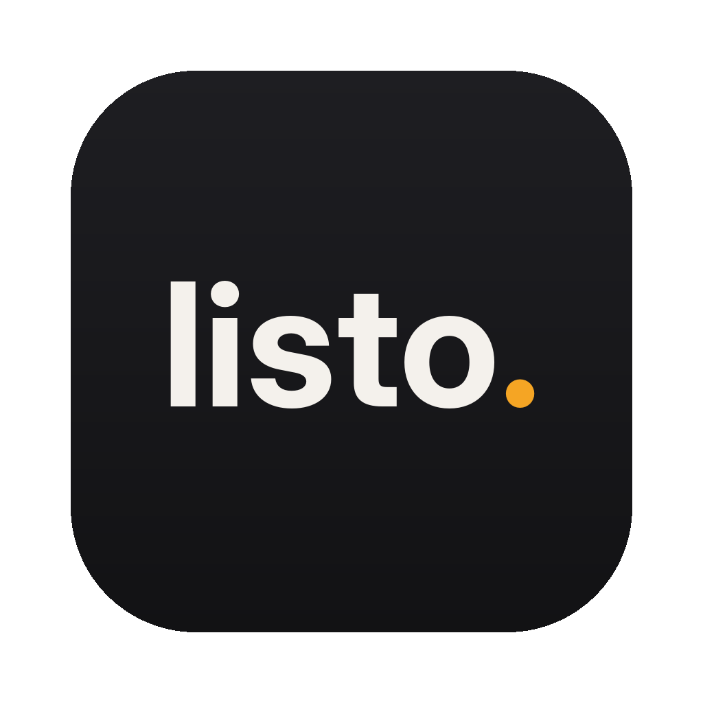

<p align="center"></p>

<h1 align="center">listo.</h1>
<p align="center"><b>Drop it in. Get it back edit-ready.</b><br>
A batch converter for video, photos and audio, with nothing else to install. Runs on Mac, Windows and Linux.</p>

---

## Download

Grab the latest build from the **[Releases page](../../releases/latest)**:

| Your computer | Download |
|---|---|
| Mac with Apple Silicon (M1 and newer) | `Listo-mac-apple-silicon.dmg` |
| Intel Mac | `Listo-mac-intel.dmg` |
| Windows | `Listo-windows-setup.exe` (or the portable `.zip`) |
| Linux | `Listo-linux-x64.AppImage` → double-click (allow it to run the first time) |

ffmpeg and everything else comes bundled. There's no Homebrew, Python or terminal needed.

**First launch on a Mac:** the app isn't signed with a paid Apple developer account yet, so macOS may say it can't check it. Open **System Settings → Privacy & Security**, scroll down and click **Open Anyway**. You only have to do this once.
**First launch on Windows:** if SmartScreen pops up, click **More info → Run anyway**.

## What it does

**Video**: ProRes (Proxy / LT / 422 / HQ / 4444), DNxHR (LB / SQ / HQ / HQX / 444), H.264, HEVC, AV1, WebM, GIF, half-res edit proxies, **Rewrap** (no re-encode, instant and lossless) and audio extraction.
Reads MOV, MP4, MTS/M2TS, MXF, AVI, MKV, MOD/TOD, MPG, VOB, DV, WMV, FLV, 3GP, WebM and more.

**Photos**: JPEG, PNG, TIFF, WebP and HEIC, from any of those plus **camera RAW** (CR2, CR3, NEF, ARW, DNG, RAF, ORF, RW2…). Optional resize; EXIF and color profile kept.

**Audio**: WAV (24/16-bit), AIFF, FLAC, MP3 and AAC.

**Built for footage:**
- **Your originals are never overwritten.** If a new file would land on top of the source (even `IMG_0001.MOV` → `IMG_0001.mov` on a Mac), it gets a number instead.
- Interlaced footage is detected and deinterlaced, with a choice of smooth 59.94p or film-look 29.97p.
- ProRes/DNxHR/Rewrap keep **every audio track** as uncompressed PCM at the source bit depth.
- **Timecode** and creation dates are carried over, and so are file dates, including "Date Created" on Mac and Windows.
- iPhone **HDR** (HLG/PQ) is tone-mapped for H.264, WebM and GIF so it doesn't look washed out, and kept as HDR for ProRes, HEVC and AV1.
- Odd-sized video (screen recordings, crops) just works.
- **Hardware encoding** (Apple VideoToolbox, NVIDIA NVENC) for H.264/HEVC when your computer has it.
- Unfinished files are written to a hidden temp file, so a cancel or crash never leaves a half-written video behind.

**Links:** paste a video link (YouTube, Vimeo, Instagram and [many more](https://github.com/yt-dlp/yt-dlp/blob/master/supportedsites.md)) and it downloads into the list — then pull the audio, make a GIF of a trimmed snippet, or convert it to anything else. Downloads go to *Downloads › Listo*. Uses [yt-dlp](https://github.com/yt-dlp/yt-dlp), fetched on first use and kept up to date automatically. Only download videos you have the rights to use.

**Trim:** click ✂ on any video or audio file to keep just part of it (with frame previews). Burned-in and embedded timecode follow the cut.

**Workflow:**
- **Recipes**: save your favorite format + folder + naming combos and reuse them in one click.
- **Per-file formats**: click the format tag on any file to give just that one a different format.
- **Look for review copies**: pick a LUT from your LUT folder (or any `.cube` file) and burn in timecode, the file name and the date & time the clip was shot (read from the clip, with a running clock). Choose a clean style or a **VHS camcorder** style (PLAY ►, date and clock in a VCR font).
- **Frame**: desqueeze anamorphic footage (1.33×–2×), and change the shape to 16:9, 8:5, 4:3, 1:1, 4:5, 9:16, 1.85, 2:1, 2.35 or 2.39. Crop to fill, add black bars, or draw cinema bars over the picture with adjustable opacity.
- **Size** means the short edge, so 1080 gives 1920×1080 for widescreen and 1080×1920 for vertical video. It scales up too (old 720×480 camcorder footage at 1080 comes out 1440×1080, in its true 4:3 shape).
- **Captions**: Listo listens to each clip on your computer (nothing is uploaded), you check and fix the words, then they're burned in (Clean or VHS look) and/or saved as an .srt file. The speech model downloads once the first time (150 MB to 1.6 GB depending on accuracy). While you check them you can play the clip with sound and watch each caption light up as it's spoken.
- **Join into one video**: turn every clip in the list into one long video, matched to the first clip's size and frame rate, without a second re-encode.
- **Preview**: see one frame of any clip exactly as it will come out, side by side with the original.
- **Double-checks every file**: re-reads each new video/audio file and flags it if the length doesn't match.
- **Two at once**: optionally convert two files side by side.
- **Right-click**: on Mac, *Open With → Listo* (or drop on the Dock icon); on Windows, *Send to → Listo*. Files go into the open window.

**Naming:** build the output name from tokens, with a live preview:

| Token | Example |
|---|---|
| `{name}` | `A001_C003` |
| `{preset}` | `prores422` |
| `{date}` / `{time}` | `2026-10-08` / `143005` (shoot date when the file has one) |
| `{res}` / `{height}` | `1920x1080` / `1080p` |
| `{fps}` | `23.976` |
| `{n}` | `001` (counter) |
| `{folder}` | name of the folder the file came from |
| `{ext}` | original extension |

`{date}_{name}_{preset}` → `2026-10-08_A001_C003_prores422.mov`

Save next to the original, in a subfolder next to it, or all in one folder. If a name is taken: add a number, skip, or replace.

## Run from source

```bash
git clone https://github.com/<you>/listo.git && cd listo
python3 -m venv .venv && source .venv/bin/activate      # Windows: .venv\Scripts\activate
pip install -r requirements-dev.txt
python scripts/fetch_ffmpeg.py     # downloads ffmpeg into vendor/ (or have ffmpeg on your PATH)
python -m listo                    # the app
python -m listo cli FILES --video h264 --naming "{name}_{preset}"   # command line
python -m pytest -q                # tests
```

Build the app yourself: `pyinstaller listo.spec --noconfirm` → `dist/`.

## Making a release

Builds run on GitHub for every push. To publish downloads:

```bash
# bump __version__ in listo/__init__.py, then:
git tag v2.0.1 && git push --tags
```

GitHub Actions builds the Mac (Apple Silicon and Intel), Windows and Linux versions, tests each one, and attaches them to a new Release.

### Optional: signing the Mac app
To get rid of the "can't check this app" warning you need an Apple Developer account ($99/yr). Add these repository secrets and the workflow will sign and notarize automatically: `MACOS_CERTIFICATE` (base64 .p12), `MACOS_CERTIFICATE_PWD`, `MACOS_SIGN_IDENTITY`, `APPLE_ID`, `APPLE_TEAM_ID`, `APPLE_APP_PASSWORD`.

## Changing the icon
Replace `listo/assets/icon.png` with a 1024×1024 PNG (transparent corners). The Mac and Windows icons are generated from it at build time.

## License
Copyright © Nick Venecia.

Listo's code is open source under GPL-3.0: you're welcome to read it, learn from it, change it and share it,
as long as what you share stays open source under the same license. It bundles [FFmpeg](https://ffmpeg.org) (GPL)
and other open-source components; see [THIRD_PARTY_NOTICES.md](THIRD_PARTY_NOTICES.md).

### Name and icon
The name **Listo**, the "listo." wordmark and the app icon are **not** covered by the GPL. They belong to
Nick Venecia and identify the official app. If you publish a modified version, please give it a different
name and icon so people don't mistake it for Listo. Saying that it's "based on Listo" is welcome.
